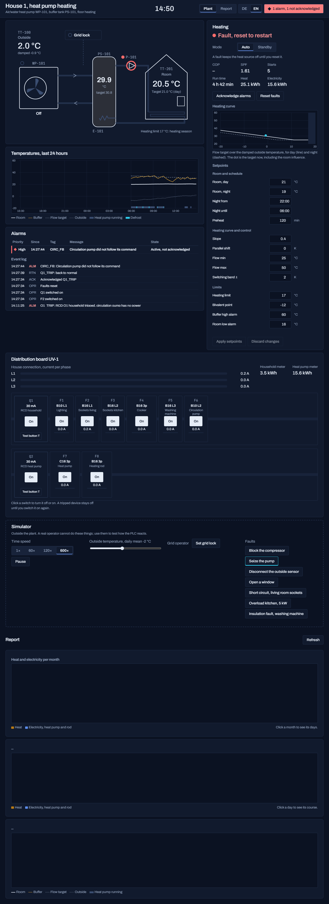
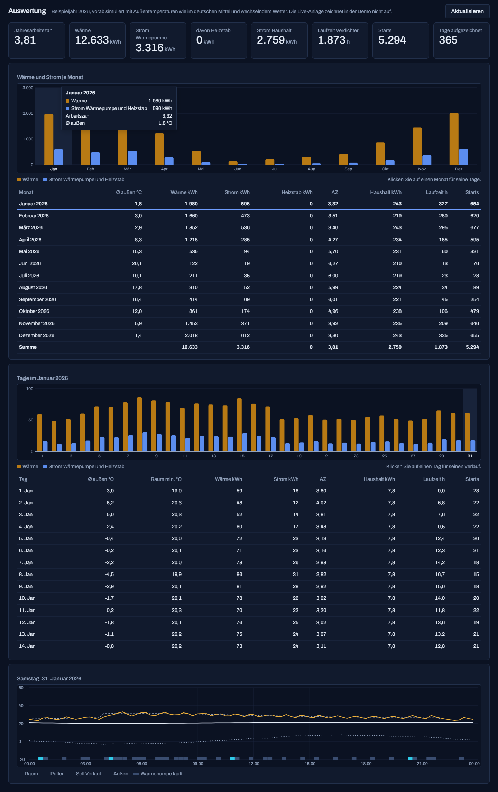

# haussim

A small house with an air/water heat pump, a 300 L buffer tank, floor heating and its distribution board, and the PLC program that heats it. It comes with a browser HMI in German and English.

**[Try the live demo ↗](https://a2m33.github.io/haussim/)** Your browser runs the same Python code through Pyodide. Set a grid lock or block the compressor and watch the PLC react, with nothing to install.

[Deutsche Fassung weiter unten](#deutsch)


I built haussim to learn how a heat pump system is controlled before I start an apprenticeship in Germany. It needs Python 3.10 or newer and no other packages.

## Run it

```
pip install git+https://github.com/A2M33/haussim
haussim run
```

Your browser opens the HMI at http://localhost:8080. Time runs 120 times faster than real time. A house reacts over hours, so pick `--speed 600` to watch a whole day in under three minutes, or `--speed 1` for real time. `--outside -10` starts a colder day.

To print a day without the HMI:

```
$ haussim simulate --days 1 --outside -5 --evu 11:00-13:00
time   outside  room   buffer target  HP     rod  COP   kWh el  starts
07:00    -9.4   19.9   31.2   35.3   RUN    off   2.7     1.8      1
08:00    -8.6   20.0   31.8   35.3   RUN    off   2.7     3.6      1
...
Heat 87.0 kWh, electricity 31.0 kWh, seasonal COP 2.81
```

## Things to try

- **Set the grid lock** (EVU-Sperre). German grid operators may switch heat pumps off for a few hours a day in return for a cheaper tariff. The PLC stops the compressor and the heating rod at once, and the buffer and the house's thermal mass carry the room through.
- **Block the compressor.** The PLC expects the running feedback within 90 seconds. Without it, the PLC latches a fault, raises a high priority alarm and lets the 6 kW heating rod take over.
- **Seize the circulation pump.** After 10 seconds without feedback the PLC latches a pump fault and keeps both heat sources off, because the heat has nowhere to go.
- **Disconnect the outside sensor.** The reading drops to -60 °C, the PLC calls the sensor broken and carries on with a fixed 0 °C.
- **Open a window.** The room loses about 250 W per kelvin more. The PLC raises the flow target by 2 K for every kelvin the room falls below its setpoint.
- **Change the heating curve** (Steilheit, Parallelverschiebung) and watch the line in the chart move with it.
- **Cause an insulation fault in the washing machine.** RCD Q1 trips and takes the circulation pump with it, so the heating stops too. Switch Q1 back on and it trips again at once. Find the faulty circuit the way an electrician does: switch the breakers off one by one until Q1 holds.
- **Short the living room sockets.** Breaker F2 opens instantly on its magnetic release and stays open while the short is there.
- **Overload the kitchen** with 5 kW. Breaker F3 warms up (the bar under it fills) and trips after about six minutes.
- **Press the test button** on an RCD. Electricians tell German homeowners to do this twice a year.

## The distribution board

| Device | Rating | Circuit |
| --- | --- | --- |
| Q1 | RCD 30 mA | household: F1 lighting B10, F2 living room sockets B16, F3 kitchen sockets B16, F4 cooker B16 3-pole, F5 washing machine B16, F6 circulation pump B10 |
| Q2 | RCD 30 mA | heat pump: F7 compressor C16 3-pole, F8 heating rod B16 3-pole |

The breakers in [`electrical.py`](src/haussim/electrical.py) trip like real ones. The magnetic release opens at 5 × In for type B and 10 × In for type C, which lets the compressor's inrush through. The thermal release follows (I/In)² with a three minute time constant: it never trips at 1.13 × In, trips at 1.45 × In after about five minutes and at 2.55 × In within a minute, as IEC 60898 requires. An RCD trips once the leakage behind it reaches 21 mA.


Household loads follow a weekday: light in the morning and evening, a kettle three times a day, the cooker at lunch and dinner, a wash at ten. The heat pump draws its real current from the simulation. Fault signal contacts on Q1, Q2, F6, F7 and F8 report a trip to the PLC, so it raises a named alarm instead of a vague feedback fault, and it lets the heating rod take over if F7 trips.

## How the PLC decides

The program in [`plc.py`](src/haussim/plc.py) runs once per scan, like the main cycle of a real PLC. It sees what a real controller sees: three temperature sensors, the compressor and pump feedback, the high-pressure switch, the defrost signal and the grid operator's lock.

| Situation | What the PLC does |
| --- | --- |
| Damped outside temperature changes | Sets the flow target from the heating curve, 25 to 50 °C |
| Buffer 2 K below the flow target | Starts the compressor |
| Buffer 2 K above the flow target | Stops it, after at least 6 minutes of running |
| Compressor stopped less than 10 minutes ago | Holds off the next start (Taktsperre) |
| 22:00 to 06:00 | Night setpoint 19 °C, back to 21 °C two hours early because floor heating reacts slowly |
| Damped outside temperature above 17 °C | Summer: heating off |
| Grid operator lock | Compressor and heating rod off at once |
| Below -12 °C, or the heat pump has a fault | Heating rod helps |
| Room below 7 °C or buffer below 8 °C | Frost protection, even in standby |
| Feedback missing, sensor out of range | Latches a fault and raises an alarm |

Alarms follow ISA-18.2: an alarm arrives unacknowledged and flashes, and it leaves the list once it has cleared and you have acknowledged it. The HMI follows ISA-101 like my [tanksim](https://github.com/A2M33/tanksim) project. Colour marks state only: cyan for running equipment, amber for the grid lock and medium alarms, red for faults. The buffer tank is the one exception. It fills from grey towards amber as it heats, because its temperature is the first thing you read.



## The model

| Part | Numbers |
| --- | --- |
| House | 120 m², heat loss 150 W/K (5 kW at -12 °C), time constant about 37 h |
| Heat pump | 7 kW at A2/W35, COP from 45 % of Carnot, defrost after 45 min of running below 6 °C |
| Buffer tank | 300 L, high-pressure switch trips at 62 °C |
| Floor heating | 360 W/K between buffer and room |
| Heating rod | 6 kW |

On a day with a mean of -2 °C the room stays between 20.5 and 21 °C and the seasonal COP comes out at about 3, in line with real air/water heat pumps on floor heating. The [wiki notes](wiki/README.md) explain each number.

## The plant log and the report

Start haussim with `--db plant.db` and it writes the plant into an SQLite file, one sample a minute. Start it again with the same file and it picks up on the next day. The report view (Auswertung) shows the log by month and by day, with the course of any single day and its events. The live demo comes with a sample year.

Energy, starts and run time go into the log as meter readings. A day's energy is the meter at the end of the day minus the meter at the end of the day before, so the figures stay exact even with a sample every 15 minutes.

`--seasonal` lets the outside temperature follow a German year (about 1 °C in mid-January, 18 °C in mid-July) with a few days of cold or mild weather mixed in. A full year takes about four minutes:

```
$ haussim simulate --days 365 --seasonal --db year.db --every 900
month    days  outside  heat kWh  elec kWh  rod kWh  house kWh   JAZ  starts  run h
2026-01    31      1.8      1980       596        0        243   3.32     654    327
2026-02    28      3.0      1660       473        0        219   3.51     620    260
...
2026-12    31      1.4      2018       612        0        243   3.30     655    335
total                      12633      3316        0       2759   3.81    5294   1873
$ haussim report year.db
```

A seasonal performance factor (JAZ) of 3.8 fits a good air/water heat pump on floor heating. The summer months reach about 6 because haussim has no hot water tank yet.



## Tests

```
pip install -e ".[dev]"
pytest
```

The 63 tests check the breaker curves against IEC 60898, the RCDs, short circuits and overloads, and that the daily energy in the log adds up to the meters. They run a winter day, a summer day, the grid lock, a broken compressor, a seized pump, a broken outside sensor, the high-pressure switch, an open window and frost. They also check every HMI command and the HTTP server's guard against commands from other websites.

---

<a id="deutsch"></a>

# haussim (Deutsch)

Ein kleines Haus mit Luft/Wasser-Wärmepumpe, 300-L-Pufferspeicher, Fußbodenheizung und Unterverteilung, dazu das SPS-Programm, das es heizt. Mit Browser-HMI auf Deutsch und Englisch.

**[Live-Demo öffnen ↗](https://a2m33.github.io/haussim/)** Ihr Browser führt denselben Python-Code mit Pyodide aus. Setzen Sie eine EVU-Sperre oder blockieren Sie den Verdichter und sehen Sie zu, wie die SPS reagiert.

Ich habe haussim gebaut, um vor meiner Ausbildung in Deutschland zu lernen, wie man eine Wärmepumpenanlage regelt.

## Starten

```
pip install git+https://github.com/A2M33/haussim
haussim run
```

Der Browser öffnet die HMI unter http://localhost:8080. Mit `--speed 600` läuft ein ganzer Tag in knapp drei Minuten ab.

## Was die SPS macht

- **Heizkurve:** Soll-Vorlauf aus der gedämpften Außentemperatur, mit Steilheit, Parallelverschiebung und Raumeinfluss
- **Nachtabsenkung** auf 19 °C, mit zwei Stunden Aufheizvorlauf, weil die Fußbodenheizung träge ist
- **Verdichter:** Zweipunktregelung auf den Puffer, Mindestlaufzeit 6 min, Taktsperre 10 min
- **EVU-Sperre:** Verdichter und Heizstab sofort aus
- **Heizstab** unter dem Bivalenzpunkt (-12 °C) und als Reserve bei einer Störung der Wärmepumpe
- **Abtauung** und **Hochdruckstörung** der Wärmepumpe
- **Frostschutz** auch in Bereitschaft, mit Hysterese
- **Überwachung:** Rückmeldung von Verdichter und Heizkreispumpe, Fühlerbruch mit Ersatzwert
- **Alarme nach ISA-18.2**, HMI nach ISA-101

## Unterverteilung

- **FI-Schutzschalter Q1 und Q2**, 30 mA, mit Prüftaste
- **Leitungsschutzschalter** B10, B16 und C16 (Verdichter), thermisch und magnetisch auslösend nach IEC 60898
- **Fehlersignalkontakte** melden der SPS, welcher Schalter ausgelöst hat
- **Fehlersuche:** Bei einem Isolationsfehler löst Q1 sofort wieder aus. Schalten Sie die Leitungsschutzschalter nacheinander aus, bis Q1 hält.

## Anlagenprotokoll und Auswertung

- `--db anlage.db` schreibt die Anlage in eine SQLite-Datei und setzt beim nächsten Start am Folgetag fort.
- Energie, Starts und Laufzeit werden als Zählerstände gespeichert, die Tageswerte sind damit exakt.
- Die Ansicht „Auswertung“ zeigt Monate, Tage und den Verlauf eines Tages. Die Live-Demo hat ein Beispieljahr mit einer Jahresarbeitszahl von 3,81.
- `--seasonal` lässt die Außentemperatur einem deutschen Jahr folgen, mit wechselndem Wetter.

## Lizenz

MIT
